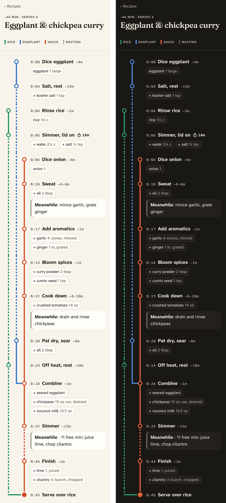

# Cookline

Photograph a recipe and get a **transit map** of it: a phone-sized chart where each part of the dish is a colored line, steps are stations in the order you start them, and lines merge where parts combine. At a glance you can see what runs in parallel, when your hands are free, and what to prep during that downtime, so you don't need full mise en place before you start.

<p align="center">
  
</p>

## Reading the map

- **Lines** are the parts of the dish (rice, eggplant, sauce). The rightmost line is the one the dish is finished in. The legend stays at the top of the screen; tap an entry to highlight its line.
- **Solid** means hands on or tending the pan. **Dashed** means waiting: simmering covered, resting, rising.
- **Meanwhile** notes are small prep (mince, grate, juice) fitted into the downtime before it's needed.
- **Times are estimates** (`~8m`), because 12 minutes is hardly ever 12 minutes. The doneness cue ("until translucent") is one tap away. The rare time that really matters, like soft-boiled eggs, is marked exact (`⏱ 7m`).
- **A broken line** (`//`) marks a long wait with nothing for you to do, like a dough rise.

## How it works

```
photo(s) or text ──► vision model via OpenRouter ──► recipe graph (JSON, schema-checked)
                                                          │  invalid → one repair pass
                                                          ▼
                       transit map ◄── layout ◄── single-cook scheduler
```

The model only extracts the recipe's structure: the parts, the steps, what's added where, how much attention each step needs, and time estimates. Everything else is plain, tested code: the scheduler (one pair of hands, long waits started early, food finished just in time, prep slotted into downtime) and the layout. Edits re-render instantly without another model call.

## Running it

```sh
npm install
npm run dev      # http://localhost:5173
npm test
npm run build    # static site in dist/
```

Open **Settings** and paste an [OpenRouter](https://openrouter.ai) API key, then tap **New recipe**. The example recipes on the home screen work without a key.

## Costs and privacy

- **No server and no subscription.** It's a static site, and the browser calls OpenRouter directly.
- **You pay OpenRouter per recipe read.** The default model is Claude Haiku 5.5, which costs a fraction of a cent per recipe. You can choose another model in Settings.
- **Your key stays on your device** (in `localStorage`) and is only ever sent to openrouter.ai. Setting a credit limit on the key is a good idea.

## Deploying

Pushing to `main` runs `.github/workflows/deploy.yml`, which tests, builds and publishes to GitHub Pages. To set it up once, open the repo's **Settings → Pages** and set **Source** to **GitHub Actions**.

## Project layout

```
src/model/     recipe types, wire schema (zod), validation
src/extract/   OpenRouter client, extraction prompt, repair pass, photo downscaling
src/schedule/  single-cook scheduler and prep placement
src/layout/    lanes and rows for the map (pure functions)
src/ui/        Preact screens and the transit map
fixtures/      hand-written recipes covering the main shapes
SPEC.md        the full spec: data model, scheduling rules, style system, prompt
```

## Status

Done:
- Milestone 1: the renderer
- Milestone 2: the scheduler
- Milestone 3: extraction (not yet tried with a real OpenRouter key)

Next:
- the recipe library with offline use
- an edit screen
- a model eval

See `SPEC.md` §11.
